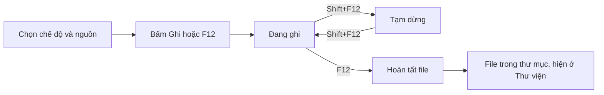
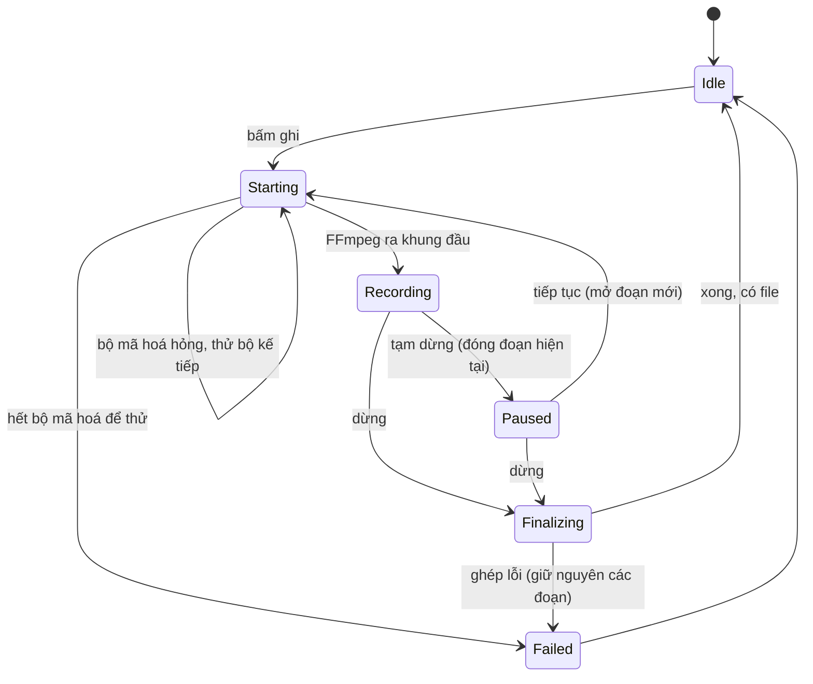

# Domain: Recora

_Cập nhật: 2026-10-31 · Nguồn: yêu cầu của chủ sản phẩm, research `docs/research/`_

## 1. Thuật ngữ

| Thuật ngữ | Định nghĩa | Tên trong code | Ghi chú |
|---|---|---|---|
| Chế độ quay | Cách chọn thứ cần ghi: toàn màn hình, vùng, cửa sổ, game, thiết bị, chỉ âm thanh | `CaptureMode` | |
| Nguồn hình | Thứ cụ thể đang ghi: một màn hình, một hình chữ nhật trên màn hình, một cửa sổ, một webcam | `CaptureSource` | |
| Phiên ghi | Từ lúc bấm ghi tới lúc file cuối cùng được lưu | `RecordingSession` | |
| Đoạn | Phần ghi liên tục giữa hai lần tạm dừng; mỗi đoạn là một tiến trình FFmpeg và một file `.mkv` tạm | `Segment` | |
| Hoàn tất | Ghép các đoạn và chuyển sang định dạng người dùng chọn (MP4, MKV...) | `Finalize` | chỉ chép luồng, không mã hoá lại |
| Bộ mã hoá | Phần cứng hoặc phần mềm nén video: NVENC, AMF, QSV, Media Foundation, x264 | `EncoderKind` | |
| Mức chất lượng | Rất nét / Cân bằng / Nhẹ, quy ra tham số của từng bộ mã hoá | `QualityPreset` | |
| Tiếng hệ thống | Âm thanh máy đang phát (loa, tai nghe), bắt bằng WASAPI loopback | `SystemAudio` | |

## 2. Vai trò
Chỉ có một vai trò: người dùng máy tính đang chạy app. Không tài khoản, không phân quyền, không máy chủ, nên không có bảng quyền.

## 3. Luồng chính

### 3.1 Quay video

### 3.2 Chụp ảnh
F11 → chụp đúng nguồn của chế độ đang chọn → lưu PNG hoặc JPG, tuỳ chọn chép vào clipboard.

## 4. Vòng đời phiên ghi

## 5. Quy tắc

| ID | Quy tắc | Ví dụ | Nguồn |
|---|---|---|---|
| BR-01 | Không bao giờ mất phần đã ghi: mỗi đoạn ghi vào `.mkv` (đọc được kể cả khi app hay máy tắt ngang); lần mở sau tự hoàn tất các đoạn còn sót | mất điện ở phút 40 → mở lại app có file 40 phút | suy ra từ yêu cầu |
| BR-02 | Mặc định ghi bằng GPU; tự chọn bộ mã hoá theo hãng GPU, hỏng thì tự thử bộ kế tiếp, mọi bộ mã hoá GPU (kể cả lùi về H.264) được thử trước CPU; CPU là đường cuối, x264 trước Media Foundation | GPU Intel vẽ màn hình laptop → NVENC hỏng → QSV | người dùng: "không làm giảm fps game" |
| BR-03 | Không logo chìm, không giới hạn thời gian ghi | | người dùng |
| BR-04 | Phím mặc định F12 ghi/dừng, Shift+F12 tạm dừng/tiếp, F11 chụp ảnh; đổi được; phím trùng với app khác thì báo, không im lặng | | thói quen Bandicam |
| BR-05 | Cửa sổ và viền của chính Recora không lọt vào video (trừ webcam nổi, vốn cần lọt vào) | | suy ra |
| BR-06 | Ổ đĩa còn dưới 500 MB thì dừng ghi gọn gàng và báo, không để file hỏng | | suy ra |
| BR-07 | Kích thước video luôn chẵn, vùng nhỏ nhất 160×90 | vùng 801×601 → ghi 800×600 | giới hạn của bộ mã hoá |
| BR-08 | Tên file mặc định `Recora 2026-10-31 20-15-03.mp4`, trùng tên thì thêm ` (2)` | | suy ra |
| BR-09 | App không gửi dữ liệu gì đi đâu; chỉ hỏi GitHub xem có bản mới | | chính sách thaipro.store |

## 6. Ngoại lệ

| Tình huống | Cách xử lý |
|---|---|
| Rút micro hoặc tai nghe khi đang ghi | Ghi tiếp, phần tiếng của thiết bị đó thành im lặng, báo một lần |
| Rút màn hình đang ghi | Đoạn hiện tại đóng lại, phiên hoàn tất với phần đã có, báo lỗi rõ |
| Driver GPU khởi động lại | Như trên |
| Tắt app khi đang ghi | Hỏi "Dừng và lưu?"; tắt máy thì BR-01 cứu |
| Thư mục lưu không ghi được | Báo ngay lúc bấm ghi, không bắt đầu |
| Game fullscreen độc quyền ra màn đen | Gợi ý chuyển game sang Borderless |
| Hai Recora cùng mở | Chỉ một phiên bản chạy, mở lần hai thì đưa cửa sổ cũ lên |

## 7. Câu hỏi mở
- [ ] "Quanh con trỏ" cần chép khung về CPU để cắt theo chuột: nặng hơn các chế độ khác; giữ nếu đo thấy chấp nhận được.
