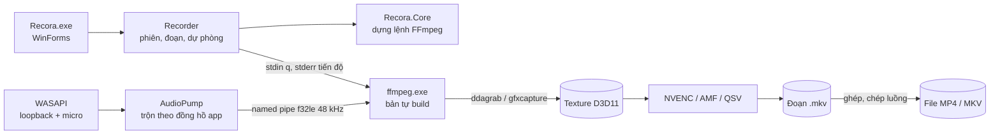

# Architecture: Recora

## 1. Tổng quan

Recora.exe là app WinForms nhỏ lo giao diện, phím tắt, bắt tiếng và điều khiển FFmpeg. Mỗi đoạn ghi là một tiến trình `ffmpeg.exe`: FFmpeg bắt hình và mã hoá ngay trên GPU, đọc tiếng từ named pipe do app ghi vào, viết ra file `.mkv` tạm. Dừng ghi thì app ghép các đoạn và chép luồng sang định dạng cuối. Mọi logic không đụng Windows (dựng lệnh, chọn bộ mã hoá, trộn tiếng, đặt tên file, vòng đời phiên) nằm trong `Recora.Core` để test được trên mọi máy.

## 2. Stack

| Lớp | Chọn | Lý do |
|---|---|---|
| Giao diện | C# WinForms, .NET Framework 4.8 | Có sẵn trong Windows 10 1903+/11 nên không bắt cài runtime; exe vài trăm KB; làm cửa sổ phủ, khay, phím tắt toàn cục dễ |
| Lõi logic | `Recora.Core`, netstandard2.0 | Test bằng xUnit trên .NET 10 ở Mac và CI |
| Bắt tiếng | NAudio 2.2.1 (WASAPI) | Thư viện MIT phổ biến; tự viết COM WASAPI rủi ro hơn |
| Bắt hình, mã hoá | FFmpeg 8.1.3 tự build (MSYS2 UCRT64, liên kết tĩnh) | Xem `docs/research/capture-encode.md` |
| Lưu cài đặt | JSON (`DataContractJsonSerializer`) ở `%AppData%\Recora` | Có sẵn trong .NET Framework, không thêm DLL |
| Build, test, đóng gói | GitHub Actions `windows-latest`; Inno Setup | Máy dev là Mac; Windows chỉ chạy được trên CI |
| Nhật ký | File text `%LocalAppData%\Recora\logs`, giữ 7 ngày | Đủ để người dùng gửi khi báo lỗi |

## 3. Module

| Module | Việc | Phụ thuộc |
|---|---|---|
| `Core/Capture` | Mô tả nguồn hình (màn hình, vùng, cửa sổ, thiết bị), kích thước chẵn | - |
| `Core/Encoding` | Danh mục bộ mã hoá, thứ tự dự phòng theo hãng GPU, quy đổi mức chất lượng | Capture |
| `Core/Ffmpeg` | Dựng đối số FFmpeg (ghi đoạn, ghép, chụp ảnh, dò bộ mã hoá), đọc dòng tiến độ | Capture, Encoding |
| `Core/Audio` | Bộ đệm vòng, trộn, giới hạn độ trễ | - |
| `Core/Recording` | Vòng đời phiên, đặt tên file và đoạn, khôi phục | Ffmpeg |
| `Core/Settings`, `Core/Hotkeys` | Cài đặt mặc định, đọc ghi, phím tắt | - |
| `App/Native` | P/Invoke user32, dwmapi, DXGI | - |
| `App/Audio` | Thiết bị WASAPI, chuyển về 48 kHz stereo, `AudioPump` ghi pipe | Core/Audio, NAudio |
| `App/Recording` | Chạy tiến trình FFmpeg, `Recorder`, dò bộ mã hoá, chụp ảnh | Core |
| `App/UI` | Cửa sổ chính, chọn vùng, viền ghi, webcam nổi, khay | mọi module trên |

## 4. Dữ liệu
Không có cơ sở dữ liệu, không nhiều khách hàng, không phân quyền.

| Dữ liệu | Ở đâu | Ghi chú |
|---|---|---|
| Cài đặt | `%AppData%\Recora\settings.json` | đọc hỏng thì dùng mặc định và giữ bản hỏng `.bak` |
| Đoạn tạm | `<thư mục lưu>\.recora\<phiên>\NNN.mkv` + `session.json` | cùng ổ với file cuối để ghép nhanh |
| Chỉ mục thư viện | `%AppData%\Recora\library.json` | thời lượng, bộ mã hoá của từng file đã ghi |
| Kết quả dò bộ mã hoá | trong `settings.json`, kèm dấu vân tay GPU + phiên bản FFmpeg | đổi GPU hoặc driver thì dò lại |

## 5. Luồng chính
- **Bắt đầu ghi:** UI → `Recorder.Start(plan)` → chọn bộ mã hoá đầu danh sách → mở named pipe → chạy `ffmpeg -f lavfi -i ddagrab=... -f f32le -i \\.\pipe\... [lọc] [mã hoá] seg.mkv` → khi pipe được mở, `AudioPump` bắt đầu ghi tiếng → dòng tiến độ đầu tiên (`frame=`) thì chuyển sang Recording. FFmpeg thoát trong 4 giây đầu mà chưa có khung: thử bộ mã hoá kế tiếp.
- **Tạm dừng:** gửi `q` vào stdin, chờ FFmpeg đóng đoạn. **Tiếp tục:** mở đoạn mới y như bắt đầu.
- **Dừng:** đóng đoạn, rồi `ffmpeg -f concat -safe 0 -i list.txt -map 0 -c copy out.mp4` (một đoạn với MKV thì chỉ đổi tên), xoá thư mục tạm.
- **Khôi phục:** lúc mở app, thư mục `.recora` còn phiên chưa hoàn tất thì hoàn tất nó.

## 6. Quy ước kỹ thuật
- Thời gian trong tên file: giờ máy. Trong `session.json`: ISO 8601 có múi giờ.
- Mọi đối số FFmpeg dựng bằng `FfmpegArgs` (một chỗ lo trích dẫn dòng lệnh Windows); không ghép chuỗi tay.
- Lỗi hiện cho người dùng là câu tiếng Việt dễ hiểu; stderr của FFmpeg chỉ vào nhật ký.
- Cấu trúc thư mục: xem `AGENTS.md`.

## 7. Quyết định kiến trúc

| # | Quyết định | Lý do | Phương án bị loại | Khó đổi? |
|---|---|---|---|---|
| 1 | Chỉ Windows 10 1903+/11 64-bit, app native C# WinForms trên .NET Framework 4.8 | Chủ sản phẩm chọn; skill vibe-desktop khuyên native khi một hệ điều hành và cần tích hợp sâu | Tauri + Svelte (WebView2 thêm ~100 MB RAM), C++ Win32 (lâu) | có |
| 2 | FFmpeg tự build tối giản, gọi như tiến trình con | ~12 MB thay vì ~200 MB; tiến trình riêng nên FFmpeg chết không kéo app chết; GPL của FFmpeg không lan sang app | Bản dựng sẵn của BtbN, tự viết Media Foundation | có |
| 3 | Khung hình ở nguyên trên GPU tới bộ mã hoá | Không tốn CPU, không tụt FPS | Chép về RAM rồi mã hoá | không |
| 4 | Tiếng do app bắt và trộn, đẩy qua named pipe; hình là input số 0 qua `-f lavfi` | FFmpeg không có WASAPI loopback; thứ tự input giữ hình tiếng khớp | dshow (không có loopback), `-filter_complex` (tiếng trễ) | không |
| 5 | Ghi từng đoạn `.mkv`, hoàn tất bằng chép luồng | Không mất video khi tắt ngang (BR-01); tạm dừng không cần mã hoá lại | Ghi thẳng MP4 (hỏng nếu tắt ngang), MP4 phân mảnh (nhiều trình sửa video đọc kém) | không |
| 6 | Mã nguồn mở MIT, kho công khai `HoangThai18/recora` | Chủ sản phẩm chọn | Kho riêng | có |
| 7 | Phát hành qua GitHub Releases, tag `recora-x.y.z`, trang tải thaipro.store đọc Release; kèm mã nguồn FFmpeg và x264 đúng phiên bản | Như các app khác của thaipro.store; GPL bắt buộc kèm mã nguồn | Microsoft Store | không |
| 8 | Kiểm tra bản mới bằng API Release của GitHub rồi mở trang tải; chưa tự cài | Không có khoá ký; người dùng tải qua trình duyệt là an toàn | Tự tải và chạy bộ cài | không |
| 9 | Chưa ký số Authenticode | Chưa có chứng thư; trang tải đã nói rõ cách mở | | không |

## 8. Rủi ro kỹ thuật

| Rủi ro | Khả năng | Ảnh hưởng | Giảm thiểu |
|---|---|---|---|
| Không có máy Windows thật có GPU để thử | cao | cao | CI chạy ghi thật (CPU) trên `windows-latest`; đường GPU tự dò và tự lùi; nhật ký đủ để sửa sau |
| Build FFmpeg trên MSYS2 lỗi hoặc thiếu `gfxcapture` | trung bình | trung bình | App hỏi `ffmpeg -filters` lúc chạy; thiếu thì chế độ cửa sổ bắt theo hình chữ nhật của cửa sổ |
| Lệch tiếng hình | trung bình | cao | Thứ tự input (ADR 4); `AudioPump` theo đồng hồ app, giới hạn độ trễ bộ đệm |
| Anti-virus nghi ngờ app chưa ký | trung bình | trung bình | Không làm gì giống mã độc (không hook, không tiêm DLL); Release kèm SHA-256 |
| Runner CI không có thiết bị âm thanh | cao | thấp | `--selftest` dùng nguồn tiếng im lặng tổng hợp khi không có thiết bị |
